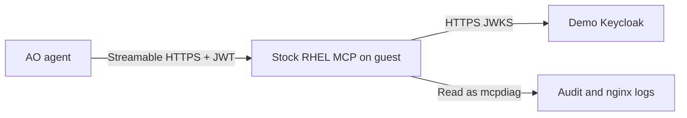

# Native RHEL MCP for AO

AO connects over HTTPS to the stock `linux-mcp-server` executable on the RHEL
webapp. The daemon uses built-in TLS, JWT verification and tool policy; native
log tools read audit and nginx files directly. No Python server wrapper, custom
collector, audit snapshot or custom MCP tool is deployed.

## Alignment with Red Hat documentation

Reviewed against [RHEL MCP documentation](https://docs.redhat.com/en/documentation/red_hat_enterprise_linux/10/html/interacting_with_the_command-line_assistant/using-the-rhel-mcp-server-to-enable-ai-assistants-to-run-discover-and-troubleshoot-complex-issues)
and [AO MCP integrations](https://docs.redhat.com/en/documentation/automation_orchestrator/2026.8/discover-agentic_steps_in_a_workflow)
on 2026-10-16. RHEL MCP is Developer Preview software.

| Area | Implementation |
| --- | --- |
| Package | Same `linux-mcp-server` package; pinned 1.7.0 with hashed dependencies in a Python 3.12 virtual environment. The RHEL guide describes uv, pip and container installation. |
| Transport | AO requires Streamable HTTP. We use native HTTPS on the guest; the RHEL guide's reference client uses STDIO and remote SSH. This is a documented architectural difference, not the exact reference recipe. |
| Identity | Non-root `mcpdiag`, no sudo or capabilities. Dedicated Keycloak client-credentials JWT, validated by the package's native verifier and policy. |
| Logs | Explicit `LINUX_MCP_ALLOWED_LOG_PATHS` includes the audit log, as shown in Red Hat's guide, and two nginx logs. `auditd` log-group configuration preserves read access after rotation. |
| Tool scope | Nine fixed diagnostic tools on localhost. Script execution and general file reads are denied by native policy. Service/journal scope is the native scope, without custom nginx argument restrictions. |
| Evidence limits | The workflow asks for 20 lines. Native tool limits apply; there is no custom enforced 20-line or 3000-character ceiling. The model receives raw audit entries, potentially including unrelated events. |
| Platform | Demo targets RHEL 9 on CNV/AWS; disposable functional tests use Rocky 9.8. The linked RHEL guide uses RHEL 10. Local tests do not establish RHEL 10 support. |

## Authentication and lifecycle

Bootstrap configures only the dedicated Keycloak client, with no realm management
roles or interactive login. Its access token lifetime is 90 days because AO
2026.8 stores bearer credentials without OAuth renewal. Rerunning setup renews
within one day of expiry; `make webapp-mcp-rotate` forces renewal. The policy
matches `azp` and the current `jti`, so an old but unexpired JWT loses tool access
after rotation. AO's health check can still authenticate that JWT until expiry;
tool discovery/execution is separately restricted by policy.

The guest receives public issuer/JWKS information and trust roots plus its TLS
leaf key/certificate. Signing keys, the Keycloak client secret and the bearer
token stay outside the guest. It must reach the Keycloak public Route to fetch
signing keys. AAP remains the audit fallback on unavailable MCP evidence.

## Staged rollout and verification

The paired openshift-gitops change must supply JWT material and update the AO
prompt/tool selection together with this playbook. After both changes are
adopted, refresh the Forgejo demojam-ansible source, configure AAP, and run
`make webapp-mcp` followed by `make webapp-mcp-verify`. Do not run the new
playbook against old opaque-token material. Setup removes the retired collector
units, runtime snapshot, custom server and credential digest.

`molecule test -s playbook-webapp-mcp` tests the production playbook, idempotence,
native audit reads after auditd rotation, nginx log rotation, reboot persistence,
read-only access and disable/revocation. Its localhost JWKS fixture is test-only.
Install the hashed runtime requirements in `.venv` before running Molecule.

`.venv/bin/python tests/test_webapp_mcp.py -v` tests the stock executable over TLS
with a test RSA issuer, invalid signatures/claims, expiration, old-token policy
denial and native log reads. Set `WEBAPP_MCP_AO_IMAGE` to the pinned AO backend
image to exercise its shipped adapter. No production collector tests remain.

Installed RHEL/SELinux behavior, actual Keycloak issuance, guest-to-Keycloak
connectivity and the full outage workflow still require live acceptance checks.
